# CO-09 — Charte graphique — Innov’Events Manager

**Version :** 13/11/2026 · **Périmètre :** site public, espaces client/administration, application Ionic PWA.

**Références :** CO-07, CO-08, CO-09, CO-10, CO-12, TR-01, TR-02, PUB-01, MOB-01 à MOB-07. La charte fixe une direction visuelle commune. Le §9 réunit les six mockups CO-10 et leurs six wireframes CO-07 d'origine, dans le même ordre.

## 1. Intentions et principes

- Identité sobre et professionnelle : vert profond pour les actions principales, fond clair et typographie neutre ; même vocabulaire visuel sur Angular et Ionic.
- Information d’abord : hiérarchie explicite, libellés compréhensibles, formulaires lisibles, progression claire dans les devis et les événements.
- Accessibilité : usage clavier, focus visible, labels, feedback textuel, reflow et zoom sans perte d’information ; ne jamais transmettre une information par la seule couleur.
- Aucune ressource externe nouvelle : police système, pas de CDN de polices ou d’icônes, aucune image ajoutée par cette charte. Les images futures seront documentées avec leur source et leur licence dans `THIRD_PARTY_NOTICES` si nécessaire.

## 2. Palette : valeurs de référence

| Famille | Jeton | Couleur | Usage |
|---|---|---|---|
| Surfaces | Blanc | `#FFFFFF` | Fond des cartes, contrôles, pages éditoriales |
| Surfaces | Fond | `#F5F8FC` | Fond général des pages |
| Surfaces | Surface secondaire | `#EDF3F7` | En-têtes de panneaux, sections alternées |
| Texte | Texte principal | `#192A3F` | Titres, paragraphes, contenus de champ |
| Texte | Texte secondaire | `#465569` | Légendes, placeholders et détails non essentiels |
| Action | Primaire | `#075E57` | CTA, sélection, repère de marque |
| Action | Primaire survol | `#05473F` | CTA au survol / état actif |
| Navigation | Lien | `#135DA0` | Liens et navigation |
| Navigation | Lien survol | `#0D427B` | Liens au survol |
| Contrôle | Bordure | `#687B90` | Bordures visibles de champs, boutons secondaires, panneaux interactifs |
| Contrôle | Focus | `#6D28D9` | Contour clavier distinctif |
| État | Succès texte | `#176344` | Confirmation, accepté, terminé |
| État | Succès fond | `#E6F4EB` | Fond de confirmation |
| État | Alerte texte | `#8B520A` | En attente, modification, vigilance |
| État | Alerte fond | `#FFF1D6` | Fond de vigilance |
| État | Erreur texte | `#A3212A` | Erreur, refus, annulation |
| État | Erreur fond | `#FCE9E9` | Fond d’erreur |
| État | Information texte | `#1559A8` | Information, à contacter |
| État | Information fond | `#E8F2FC` | Fond d’information |
| État | Neutre texte | `#30465E` | Brouillon, en préparation |
| État | Neutre fond | `#E9EFF6` | Fond neutre |
| Inactif | Désactivé texte | `#59667A` | Libellé non activable |
| Inactif | Désactivé fond | `#E2E7EE` | Fond non activable |

## 3. Mesures de contraste

Calcul selon WCAG/RGAA : luminance relative sRGB puis **(L la plus claire + 0,05) / (L la plus sombre + 0,05)**. Rapports arrondis à deux décimales. Minimum appliqué : **4,5:1 pour tout texte courant** (y compris les petits libellés) et **3:1 pour les contours, indicateurs visuels et composants interactifs**. Pour les grands textes, 3:1 serait suffisant, mais les couleurs retenues atteignent 4,5:1. Les tableaux des §3 et §7 bis décrivent les **associations autorisées** ; ne pas inventer de nouvelles paires sans les recalculer.

**Critères de référence — RGAA 4.1.2 :** **3.2**, contraste du texte avec son arrière-plan ; **3.3**, contraste des composants d'interface et des éléments graphiques porteurs d'information avec les couleurs contiguës ; **10.7**, visibilité de la prise de focus. Les valeurs calculées ci-dessous ne constituent pas un audit des interfaces réalisées. Référentiel : [Critères et tests du RGAA](https://accessibilite.numerique.gouv.fr/methode/criteres-et-tests/).

| Premier plan | Fond | Rapport | Seuil | Résultat | Usage |
|---|---|---:|---:|---|---|
| Texte principal `#192A3F` | Blanc `#FFFFFF` | **14.54:1** | 4,5:1 | Conforme | Texte courant / formulaires |
| Texte principal `#192A3F` | Fond `#F5F8FC` | **13.65:1** | 4,5:1 | Conforme | Texte courant sur page |
| Texte principal `#192A3F` | Surface secondaire `#EDF3F7` | **12.99:1** | 4,5:1 | Conforme | Titres des sections |
| Texte secondaire `#465569` | Blanc `#FFFFFF` | **7.60:1** | 4,5:1 | Conforme | Métadonnées et placeholders |
| Texte secondaire `#465569` | Fond `#F5F8FC` | **7.13:1** | 4,5:1 | Conforme | Texte secondaire |
| Texte secondaire `#465569` | Surface secondaire `#EDF3F7` | **6.79:1** | 4,5:1 | Conforme | Informations complémentaires |
| Primaire `#075E57` | Blanc `#FFFFFF` | **7.64:1** | 4,5:1 | Conforme | Titres et navigation sur fond blanc |
| Primaire `#075E57` | Fond `#F5F8FC` | **7.18:1** | 4,5:1 | Conforme | Accent texte sur page |
| Primaire `#075E57` | Surface secondaire `#EDF3F7` | **6.83:1** | 4,5:1 | Conforme | Accent texte sur panneaux |
| Blanc `#FFFFFF` | Primaire `#075E57` | **7.64:1** | 4,5:1 | Conforme | Bouton principal / hero uni |
| Blanc `#FFFFFF` | Primaire survol `#05473F` | **10.61:1** | 4,5:1 | Conforme | Bouton principal survol |
| Primaire `#075E57` | Blanc `#FFFFFF` | **7.64:1** | 3:1 | Conforme | Bordure bouton secondaire |
| Primaire survol `#05473F` | Blanc `#FFFFFF` | **10.61:1** | 3:1 | Conforme | Bordure bouton secondaire au survol |
| Erreur texte `#A3212A` | Blanc `#FFFFFF` | **7.48:1** | 4,5:1 | Conforme | Bouton destructif / message erreur |
| Blanc `#FFFFFF` | Erreur texte `#A3212A` | **7.48:1** | 4,5:1 | Conforme | Bouton destructif rempli |
| Lien `#135DA0` | Blanc `#FFFFFF` | **6.77:1** | 4,5:1 | Conforme | Lien sur carte blanche |
| Lien `#135DA0` | Fond `#F5F8FC` | **6.36:1** | 4,5:1 | Conforme | Lien sur fond de page |
| Lien `#135DA0` | Surface secondaire `#EDF3F7` | **6.05:1** | 4,5:1 | Conforme | Lien sur panneau secondaire |
| Lien survol `#0D427B` | Blanc `#FFFFFF` | **10.08:1** | 4,5:1 | Conforme | Lien survol sur carte |
| Lien survol `#0D427B` | Fond `#F5F8FC` | **9.47:1** | 4,5:1 | Conforme | Lien survol sur page |
| Lien survol `#0D427B` | Surface secondaire `#EDF3F7` | **9.01:1** | 4,5:1 | Conforme | Lien survol sur panneau |
| Bordure `#687B90` | Blanc `#FFFFFF` | **4.35:1** | 3:1 | Conforme | Contour champ / carte / bouton |
| Bordure `#687B90` | Fond `#F5F8FC` | **4.09:1** | 3:1 | Conforme | Contour sur fond de page |
| Bordure `#687B90` | Surface secondaire `#EDF3F7` | **3.89:1** | 3:1 | Conforme | Contour sur panneau secondaire |
| Focus `#6D28D9` | Blanc `#FFFFFF` | **7.10:1** | 3:1 | Conforme | Anneau de focus sur fond blanc |
| Focus `#6D28D9` | Fond `#F5F8FC` | **6.67:1** | 3:1 | Conforme | Anneau de focus sur fond de page |
| Focus `#6D28D9` | Surface secondaire `#EDF3F7` | **6.35:1** | 3:1 | Conforme | Anneau de focus sur panneau |
| Blanc `#FFFFFF` | Primaire `#075E57` | **7.64:1** | 3:1 | Conforme | Contour de focus entouré d'une surface primaire |
| Blanc `#FFFFFF` | Primaire survol `#05473F` | **10.61:1** | 3:1 | Conforme | Contour de focus entouré d'une surface primaire survol |
| Blanc `#FFFFFF` | Erreur texte `#A3212A` | **7.48:1** | 3:1 | Conforme | Contour de focus entouré d'une surface rouge |
| Primaire survol `#05473F` | Surface secondaire `#EDF3F7` | **9.48:1** | 4,5:1 | Conforme | Texte du bouton secondaire au survol |
| Succès texte `#176344` | Succès fond `#E6F4EB` | **6.37:1** | 4,5:1 | Conforme | Message validé / terminé |
| Alerte texte `#8B520A` | Alerte fond `#FFF1D6` | **5.68:1** | 4,5:1 | Conforme | Message en attente / attention |
| Erreur texte `#A3212A` | Erreur fond `#FCE9E9` | **6.40:1** | 4,5:1 | Conforme | Erreur / refus / annulation |
| Information texte `#1559A8` | Information fond `#E8F2FC` | **6.13:1** | 4,5:1 | Conforme | Information / à contacter |
| Neutre texte `#30465E` | Neutre fond `#E9EFF6` | **8.39:1** | 4,5:1 | Conforme | En préparation / état neutre |
| Désactivé texte `#59667A` | Désactivé fond `#E2E7EE` | **4.69:1** | 4,5:1 | Conforme | Libellé contrôle désactivé (exception AA non requise) |

**Focus : choisir la couleur selon le fond autour du contrôle.** Le contour de 3 px est décalé de 3 px : son contraste se mesure avec la surface sur laquelle il est dessiné, et non avec la seule couleur de remplissage du bouton. Sur blanc, fond général ou surface secondaire, utiliser le violet `#6D28D9`. Si le contour est effectivement entouré de primaire `#075E57`, de primaire survol `#05473F` ou de rouge `#A3212A`, utiliser le blanc `#FFFFFF`. Un bouton rouge ou vert posé sur une carte blanche conserve donc un contour violet. Ne pas choisir le blanc uniquement parce que le bouton est rempli d'une couleur sombre : blanc sur blanc = 1:1. Le violet sur primaire ne donne que 1,08:1 et n'est pas autorisé pour ce contour.

Sur photo ou fond non uniforme, placer le contrôle dans un cartouche opaque blanc assez large pour contenir le contour et son décalage. Tout autre fond doit faire l'objet d'un calcul et d'une vérification du rendu ; le contour ne doit pas être coupé ou masqué. Les éléments désactivés ne sont pas soumis au minimum de contraste, mais le couple retenu atteint 4,5:1.

## 4. Typographie

- **Police :** `system-ui, -apple-system, BlinkMacSystemFont, "Segoe UI", Arial, sans-serif`. Les fontes proviennent du système de l’utilisateur, sans téléchargement et sans ressource à redistribuer ; compatible avec `font-src 'self'`. Aucun ajout à `THIRD_PARTY_NOTICES` pour cette famille.
- **Corps :** 16 px, graisse 400, interligne 1,5 (24 px), espacement entre paragraphes 16 px ; texte principal sur blanc ou fond clair.
- **Texte secondaire :** 14 px minimum, interligne 1,5 ; ne jamais le rendre indispensable uniquement dans un placeholder.
- **H1 :** 32 px / 40 px (mobile : 28 px / 36 px), graisse 700 ; **H2 :** 26 px / 34 px ; **H3 :** 20 px / 28 px ; une structure sémantique cohérente par page.
- **Étiquettes de champs et boutons :** 16 px / 24 px, graisse 600 pour les actions ; messages d’erreur 14 à 16 px, jamais inférieurs à 14 px.
- Pas de texte intégré dans des images ; texte redimensionnable jusqu’à 200 %, sans perte d’action. Les titres et valeurs longues doivent pouvoir passer à la ligne.

## 5. Grille, espaces et responsive

- Échelle d’espacement **4 / 8 / 12 / 16 / 24 / 32 / 48 px**. Entre éléments liés : 8–12 px ; entre groupes : 24–32 px ; entre sections : 48 px.
- Contenu web : largeur maximum `1200px`, marge intérieure `24px` sur ordinateur, `16px` sous 768 px. Cartes : `padding: 24px` sur ordinateur, `16px` sur téléphone. Rayon : `8px` (champs et boutons), `12px` (cartes).
- **Téléphone (< 768 px)** : une colonne ; **tablette (768–1023 px)** : une ou deux colonnes selon la place ; **grand écran (≥ 1024 px)** : jusqu’à trois colonnes pour les listes, formulaires conservés dans une colonne de lecture claire.
- Cibles tactiles de boutons et liens importants : **44 × 44 px au minimum**, espacées pour éviter les erreurs de sélection. Pas de défilement horizontal à 320 px sauf composants intrinsèquement bidimensionnels explicitement justifiés.
- Sur mobile, les boutons principaux passent en largeur disponible ; les actions secondaires restent visibles sans cacher les champs derrière le clavier virtuel.

## 6. Composants et états

### Boutons

- **Primaire :** fond `#075E57`, texte blanc ; **survol :** `#05473F` ; **focus clavier :** contour de 3 px, décalé de 3 px, violet sur surface claire et blanc sur les surfaces sombres autorisées au §3, selon le fond autour du contrôle ; **activation :** feedback visible (chargement texte + indicateur) et prévention des doubles envois.
- **Secondaire :** fond blanc, texte et bordure `#075E57` (2 px) ; au survol texte/bordure `#05473F` et fond `#EDF3F7` (texte : 9,48:1) ; même règle de focus que le primaire.
- **Destructif :** fond `#A3212A`, texte blanc, confirmation textuelle avant suppression irréversible. L’erreur ne repose pas sur la seule couleur.
- **Désactivé :** fond `#E2E7EE`, texte `#59667A`, pas d’interaction. Afficher également la raison de l’indisponibilité si nécessaire ; ne pas désactiver silencieusement une action requise.

### Formulaires, messages et navigation

- Champs : fond blanc, texte principal, contour `#687B90` de 2 px ; libellé permanent au-dessus. Placeholder `#465569` sur blanc. Aide sous champ en texte secondaire.
- Champ invalide : contour et message `#A3212A` sur blanc ; `aria-invalid`, message relié par `aria-describedby`, et description explicite de l’erreur. Le contour ne suffit pas.
- Cases et boutons radio : contour visible, sélection primaire `#075E57` et coche blanche, libellé explicite ; état de focus conservé.
- Liens : `#135DA0`, soulignés en contexte ; au survol `#0D427B`, soulignement conservé. Lien d’évitement visible au focus au début du document.
- Étiquettes de statut : **texte explicite** et fond sémantique (succès, alerte, erreur, information, neutre). Exemple : « Devis accepté », pas une simple pastille verte. Les badges ont une forme d'étiquette et un fond pâle, sans soulignement ni apparence de lien ; les liens conservent leur présentation de navigation. Une information urgente comprend également une icône ou un préfixe textuel.
- Messages : bloc à fond pâle et texte foncé correspondant, avec titre/texte ; `role="alert"` seulement si l’information doit être annoncée immédiatement. Ne pas employer la couleur seule pour signaler une erreur.
- Cartes ou panneaux *interactifs* : si une bordure permet de les reconnaître comme contrôles, contour `#687B90` de 2 px ; les cartes purement décoratives n’exigent pas de bordure contrastée.
- Images : texte alternatif significatif ou `alt=""` si décoratif ; sur les photos de couverture, texte sur cartouche opaque ou sur couleur unie. Ne pas supposer qu’un voile transparent garantit le contraste.

### Familles visuelles des statuts

Cette table reprend les statuts métier de CO-02 ; elle fixe leur présentation sans créer de statut ni modifier les transitions.

| Famille | Statuts | Texte / fond |
|---|---|---|
| Neutre | brouillon, en préparation, à faire | `#30465E` / `#E9EFF6` |
| Information | à contacter, étude côté client, en cours (événement, tâche) | `#1559A8` / `#E8F2FC` |
| Alerte | modification, en attente (avis), suspendu (compte) | `#8B520A` / `#FFF1D6` |
| Succès | accepté (devis, événement), validé (avis), converti, terminé, actif | `#176344` / `#E6F4EB` |
| Erreur | refusé, annulé, échoué, supprimé (compte employé) | `#A3212A` / `#FCE9E9` |

Le libellé est toujours écrit en clair, par exemple « Devis refusé ». La suppression d'un compte client est un effacement, pas un état « supprimé » à ajouter à son cycle.

## 7. Exemple de jetons CSS à réutiliser sur web et mobile

Ces jetons décrivent la charte ; ils ne modifient pas les fichiers de l’application. Les utiliser dans les feuilles CSS/SCSS existantes sans nouvelle bibliothèque.

```css
:root {
  --page: #F5F8FC;
  --surface: #FFFFFF;
  --surface-alt: #EDF3F7;
  --text: #192A3F;
  --text-muted: #465569;
  --primary: #075E57;
  --primary-hover: #05473F;
  --link: #135DA0;
  --link-hover: #0D427B;
  --border: #687B90;
  --focus: #6D28D9;
  --success-text: #176344;
  --success-bg: #E6F4EB;
  --warning-text: #8B520A;
  --warning-bg: #FFF1D6;
  --error-text: #A3212A;
  --error-bg: #FCE9E9;
  --info-text: #1559A8;
  --info-bg: #E8F2FC;
  --neutral-text: #30465E;
  --neutral-bg: #E9EFF6;
  --disabled-text: #59667A;
  --disabled-bg: #E2E7EE;
  font-family: system-ui, -apple-system, BlinkMacSystemFont, "Segoe UI", Arial, sans-serif;
}
/* Ces classes décrivent la surface autour du contour de focus. */
.surface-light {
  --focus: #6D28D9;
}
.surface-dark {
  --focus: #FFFFFF;
}

:focus-visible {
  outline: 3px solid var(--focus);
  outline-offset: 3px;
}
```

Appliquer `.surface-dark` au conteneur dont le fond autour des contrôles est l'une des couleurs sombres autorisées au §3, et non à un bouton uniquement en raison de sa couleur. Une carte claire imbriquée dans cette surface doit rétablir `.surface-light`. Ces classes choisissent le contour ; elles ne définissent pas le fond. Le sélecteur global ne traverse pas le Shadow DOM des composants Ionic : leur adaptation et leur validation sont précisées au §7 bis.

## 7 bis. Thème Ionic 9

L'application mobile reprend la palette commune dans `apps/mobile/src/theme/variables.scss`. **Seules les valeurs `primary` et `danger` sont utilisées pour l'attribut `color` des composants Ionic.** Les autres familles de statuts utilisent les classes de la charte et leurs couples texte/fond du §6 ; ne pas utiliser les couleurs Ionic `secondary`, `tertiary`, `success`, `warning`, `medium`, `light` ou `dark` pour les remplacer.

```scss
:root {
  --ion-font-family: system-ui, -apple-system, BlinkMacSystemFont, "Segoe UI", Arial, sans-serif;
  --ion-background-color: #F5F8FC;
  --ion-background-color-rgb: 245, 248, 252;
  --ion-text-color: #192A3F;
  --ion-text-color-rgb: 25, 42, 63;

  --ion-color-primary: #075E57;
  --ion-color-primary-rgb: 7, 94, 87;
  --ion-color-primary-contrast: #FFFFFF;
  --ion-color-primary-contrast-rgb: 255, 255, 255;
  --ion-color-primary-shade: #05473F;
  --ion-color-primary-tint: #206E68;

  --ion-color-danger: #A3212A;
  --ion-color-danger-rgb: 163, 33, 42;
  --ion-color-danger-contrast: #FFFFFF;
  --ion-color-danger-contrast-rgb: 255, 255, 255;
  --ion-color-danger-shade: #8F1D25;
  --ion-color-danger-tint: #AC373F;
}
```

Les variantes `shade` et `tint` complètent les valeurs de base pour les états des composants. Le contraste du texte blanc sur les variantes supplémentaires est le suivant ; les couleurs de base et le primaire survol sont déjà mesurés au §3.

| Premier plan | Fond | Rapport | Seuil | Résultat |
|---|---|---:|---:|---|
| Blanc `#FFFFFF` | Primaire tint `#206E68` | **6.01:1** | 4,5:1 | Conforme |
| Blanc `#FFFFFF` | Danger shade `#8F1D25` | **8.86:1** | 4,5:1 | Conforme |
| Blanc `#FFFFFF` | Danger tint `#AC373F` | **6.23:1** | 4,5:1 | Conforme |

**Mode clair :** retirer l'import `@import '@ionic/angular/css/palettes/dark.system.css';` de `apps/mobile/src/global.scss`. Ne pas activer les palettes `dark.always.css` ou `dark.class.css`. Vérifier également l'application lorsque le système du téléphone est en mode sombre : la palette claire définie dans cette charte doit rester appliquée.

**Focus et composants interactifs :** les règles CSS visant les éléments HTML natifs ne suffisent pas à couvrir les contrôles internes au Shadow DOM. Adapter chaque composant Ionic au moyen de ses propriétés CSS et des parties `::part(...)` qu'il expose, selon sa documentation. La couleur du contour suit la règle du fond autour du contrôle du §3. Aucun extrait de styles non vérifié ne constitue une preuve de conformité.

À chaque ajout d'un composant interactif (bouton, lien, champ, case à cocher, bouton radio, sélecteur, onglet, menu ou fenêtre de dialogue), **vérifier au clavier** son accès avec Tab et Shift+Tab, l'activation avec les touches adaptées à son rôle, la visibilité du focus sur chaque surface utilisée, l'absence de contour coupé et la sortie du composant. Pour une fenêtre de dialogue, vérifier aussi Échap et le retour du focus au contrôle qui l'a ouverte. Vérifier les états de survol, de focus et d'activation effectivement rendus, notamment les éventuels effets d'opacité ; consigner le résultat avec le ticket concerné. Le thème n'est validé qu'après ces contrôles sur l'interface réelle.

## 8. Validation de la charte et dépendances

1. Les six mockups CO-10 et leurs six wireframes CO-07 d'origine sont intégrés au §9. Vérifier ensuite les interfaces réalisées sur cette palette, sans exception non documentée. Contrôler tout texte posé sur image ou sur fond personnalisé ; les ratios ci-dessus ne couvrent pas les images.
2. Tester au clavier (Tab, Shift+Tab, Entrée, Espace, Échap selon le composant), le focus visible, les messages et les formulaires ; vérifier chaque composant Ionic ajouté conformément au §7 bis, puis la navigation et les intitulés avec un lecteur d’écran si possible.
3. Vérifier à 320 px, 375 px, 768 px et sur écran large ; zoom 200 % et 400 %, orientation portrait/paysage, sans perte de contenu utile.
4. Exécuter un audit axe et Lighthouse sur les interfaces une fois codées (**TR-01**), puis contrôler manuellement les contrastes des composants réellement rendus, leurs états et l’ordre de focus, notamment au regard des critères RGAA **3.2, 3.3 et 10.7**. Vérifier le rendu de la PWA en mode sombre système tout en conservant le thème clair prévu.
5. Aucune police, image, icône, bibliothèque ou autre ressource externe ajoutée : **aucune nouvelle entrée THIRD_PARTY_NOTICES** au titre de CO-09. Toute ressource ajoutée dans les lots ultérieurs doit être vérifiée et recensée séparément.

## 9. Maquettes

Les six paires suivantes associent chaque wireframe CO-07 à sa maquette CO-10. Les PNG sont intégrés ci-dessous ; ils sont également inclus dans la version PDF complète. Les sources éditables des maquettes sont fournies dans CO-10-maquettes.drawio.xml.

### 9.1 W1 - Web - Demande de devis

**Wireframe CO-07 - W1**

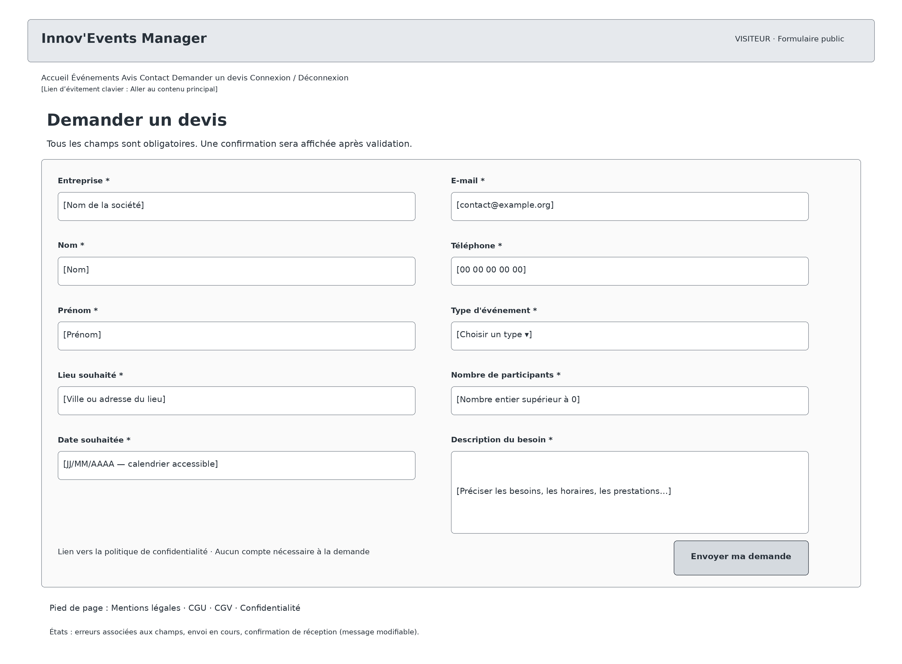

**Maquette CO-10 - W1**

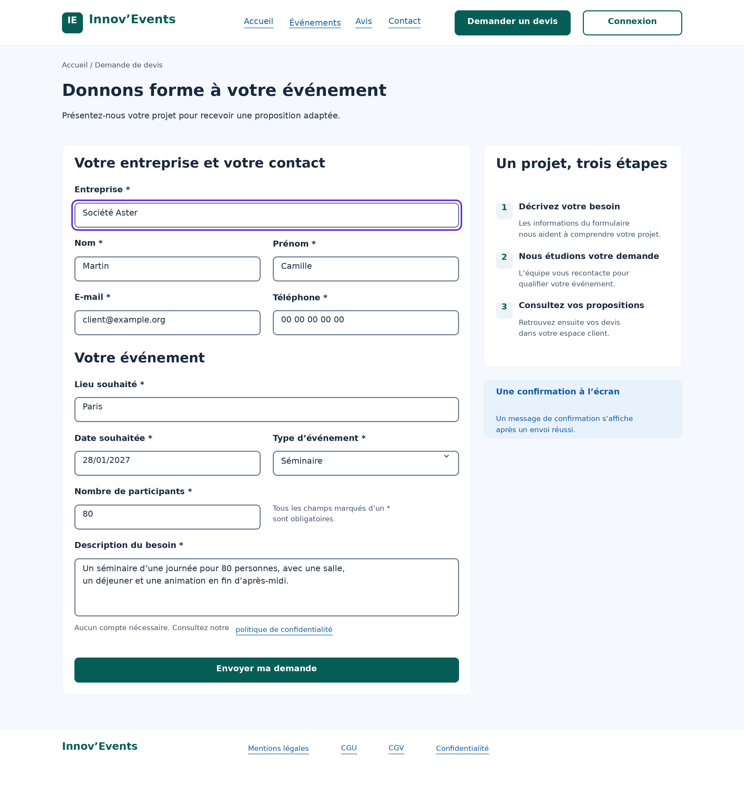

### 9.2 W2 - Web - Préparer et envoyer un devis

**Wireframe CO-07 - W2**

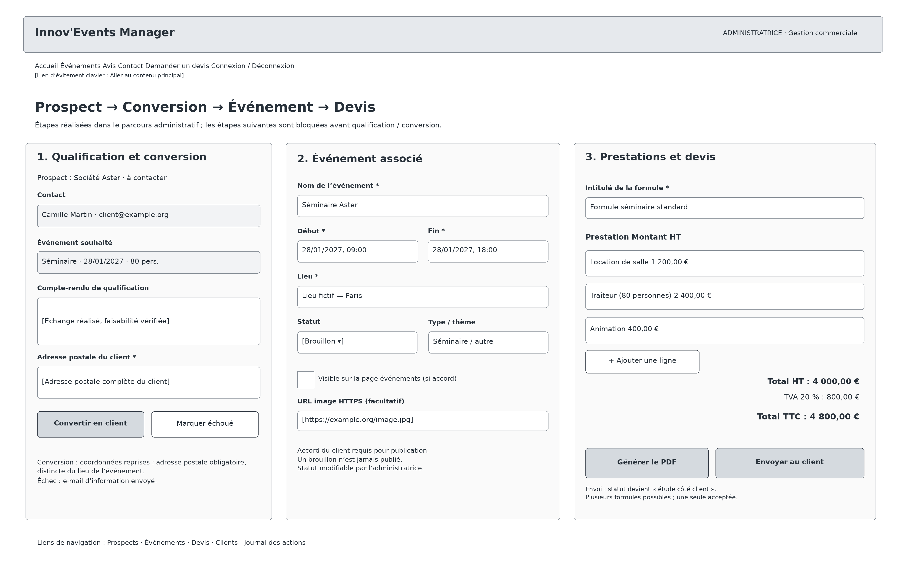

**Maquette CO-10 - W2**

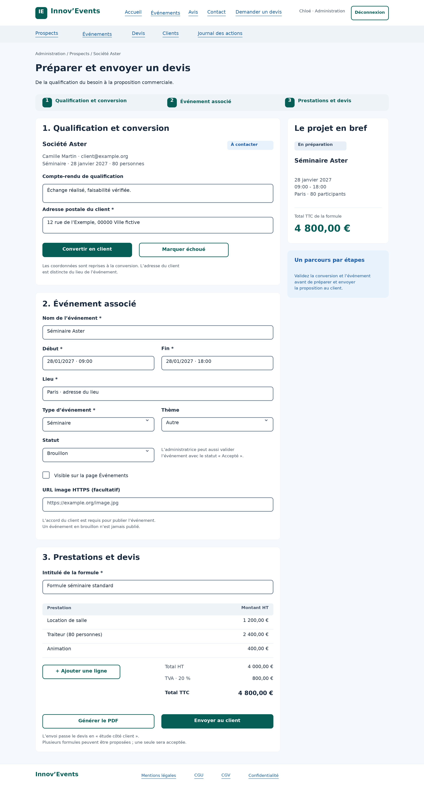

### 9.3 W3 - Web - Mes devis

**Wireframe CO-07 - W3**

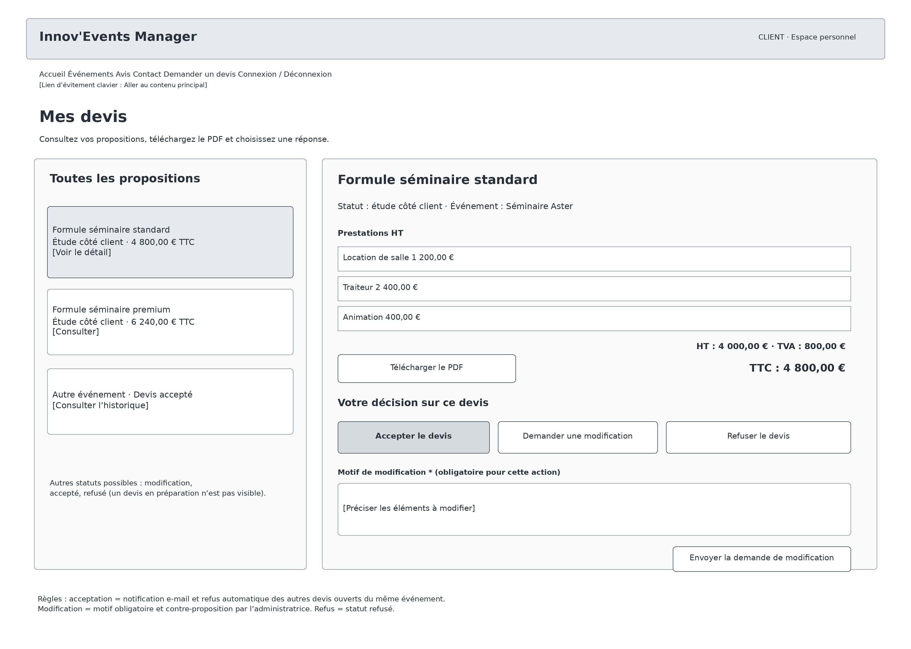

**Maquette CO-10 - W3**

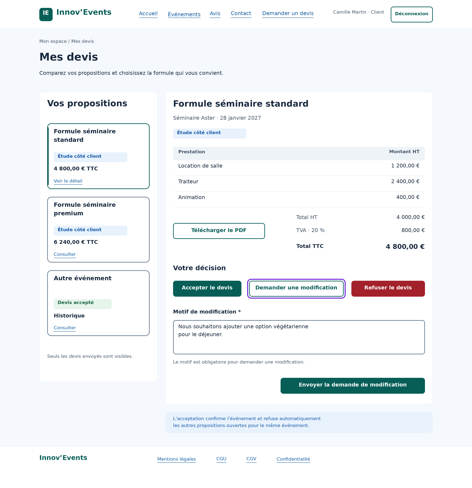

### 9.4 M1 - Mobile - Événements à venir

**Wireframe CO-07 - M1**

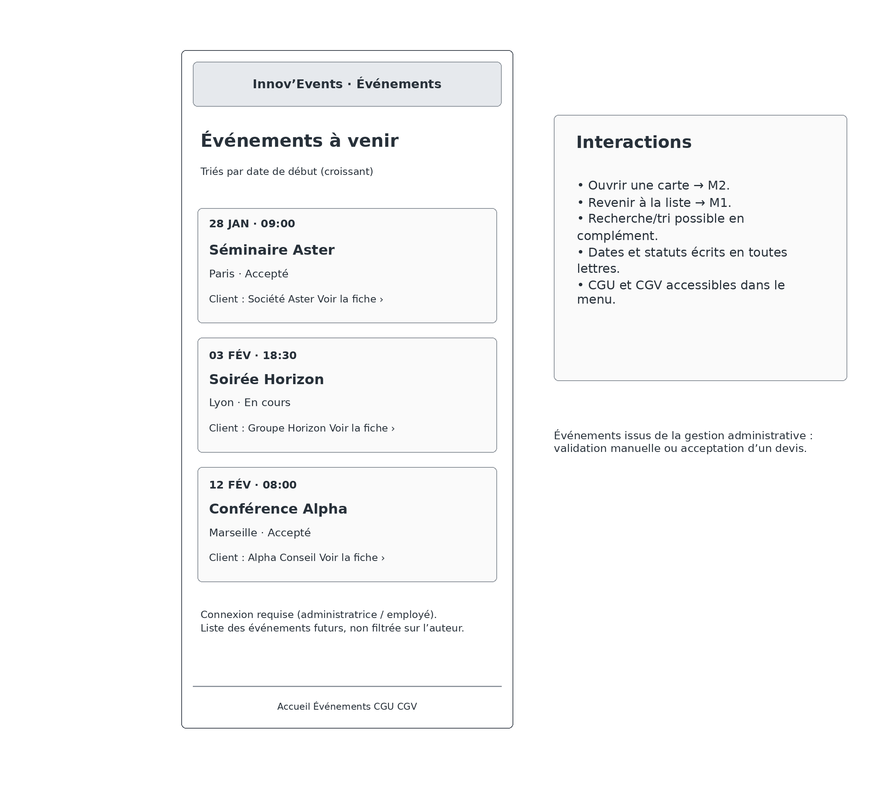

**Maquette CO-10 - M1**

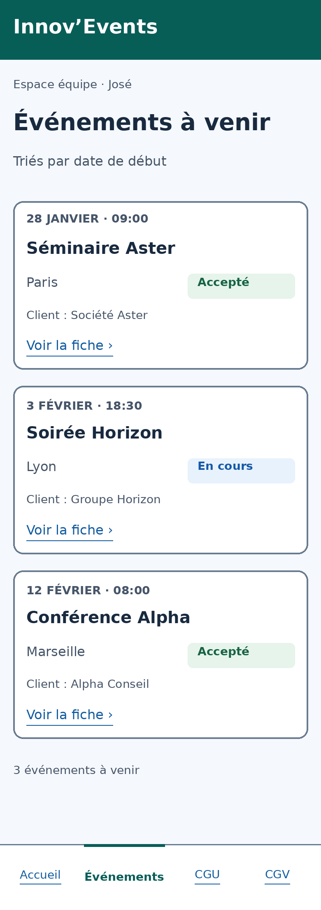

### 9.5 M2 - Mobile - Fiche événement et note

**Wireframe CO-07 - M2**

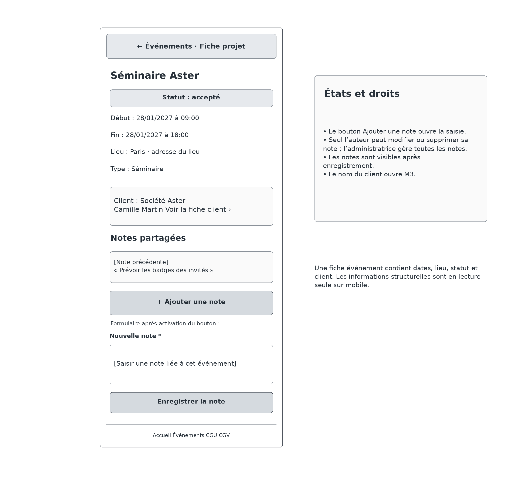

**Maquette CO-10 - M2**

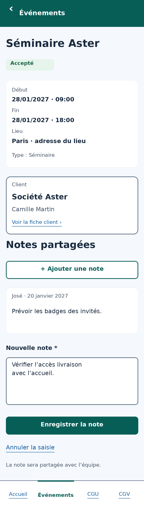

### 9.6 M3 - Mobile - Fiche client et contact

**Wireframe CO-07 - M3**

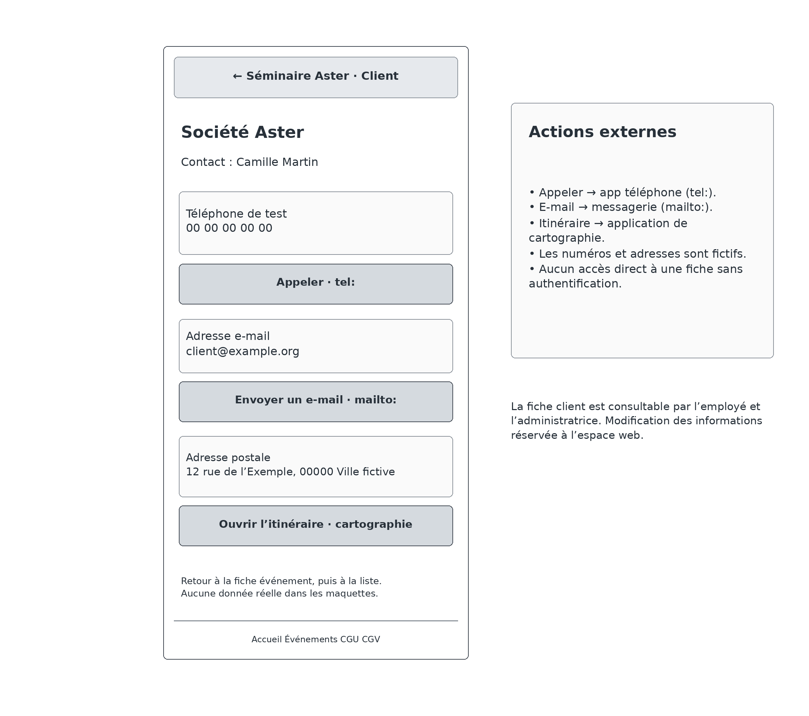

**Maquette CO-10 - M3**

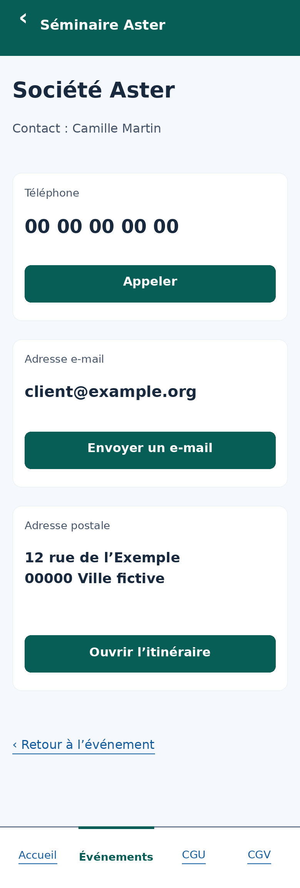

**Statut :** palette et règles visuelles spécifiées ; six wireframes et six maquettes intégrés. Les maquettes sont des représentations statiques de conception. Les adaptations du thème et le retrait de l’import sombre restent à appliquer dans le code ; conformité de l’implémentation réelle non testée.
